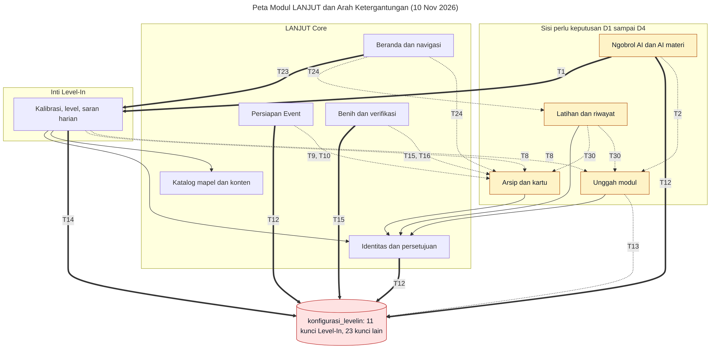

# Peta Modul v2 dan Batas Level-In

**Task:** LANJUT_002 seri v2 (Bagian 1 rencana implementasi).
**Dasar audit:** commit `166d433` repo `lippbyte/lanjut_app`, 10 November 2026.
**Sifat:** dokumen saja. Tidak ada kode, tabel, atau endpoint yang berubah.
**Diperbarui:** LANJUT_004 seri v2 mengeluarkan endpoint klaim data tamu yang sudah dihapus. Nomor baris rujukan tetap memakai commit di atas.

**Cara membaca:** rujukan berkas relatif terhadap akar repo ini dan memakai nomor baris commit di atas. "Core" berarti LANJUT Core. Kata "perlu keputusan Khalifa" berarti arahnya belum ditetapkan; pilihan dan rekomendasinya ada di Bagian 9.

**Label:** K1–K9 adalah keputusan terkunci di rencana implementasi. D1–D8 adalah keputusan di dokumen ini; semuanya masih terbuka kecuali D7, yang sudah diputuskan lewat K14. Dokumen ini mencatat 30 titik sambung: T1–T2 dan T8–T33 ada di kode produksi dan berkas kontennya, T34–T35 ada di tes. T3–T7 sudah hilang bersama endpoint klaim data tamu, dan nomornya tidak dipakai ulang supaya rujukan lama tetap benar.

Product Strategy v2.1 tidak ada di repo ini maupun repo induk, jadi kolom "Catatan v2" bersandar pada `task/rencana-implementasi-lanjut-v2.md` di repo induk.

## 1. Ringkasan

| Keputusan | Jumlah fitur |
|---|---|
| Tetap | 18 |
| Revisi | 13 |
| Tunda | 2 |
| Perlu keputusan Khalifa | 2 |
| **Total** | **35** |

Batas Level-In saat ini setengah rapi. Logika inti (`keputusan.js`, `konfigurasi.js`) berdiri sendiri. Yang kusut ada di sekitarnya. Dari 30 titik sambung yang dicatat, 28 ada di kode produksi dan berkas kontennya dan 2 ada di tes (T34–T35). Dari 28 itu, 5 pasti melanggar aturan yang diusulkan, 12 menjadi pelanggaran atau tidak tergantung keputusan D1–D4, dan 11 sah atau berupa catatan. Selain itu, semua tabel belajar terikat langsung ke tabel `pengguna`.

## 2. Peta fitur

### Akun dan gerbang

| Fitur | Layar / endpoint / tabel | Keputusan | Alasan | Catatan v2 |
|---|---|---|---|---|
| Daftar dan masuk (sandi, OTP email, Google) | `app/(auth)/masuk.tsx`, `app/(auth)/daftar.tsx`, `app/masuk-google.tsx`; `/auth/*` di `server/src/modul/auth/auth.rute.js`; `pengguna`, `sesi_pengguna`, `kode_otp_email`, `pendaftaran_tertunda`, `percobaan_masuk` | Tetap | Bagian Core, tidak terikat jalur | Dua akun terpisah dengan Level-In (K7) ditinjau saat Level-In dibangun |
| Verifikasi email dan buat sandi baru | `components/screens/VerifikasiEmail.tsx`, `components/screens/BuatSandiBaruScreen.tsx`; `/auth/email/*`, `/auth/sandi/buat`; `pengguna.batas_verifikasi`, `pengguna.wajib_buat_sandi` | Tetap | Pengaman akun | Tidak ada |
| Gerbang kelas dan jenis sekolah | `app/(app)/_layout.tsx:41-44`, `components/screens/IsiKelasScreen.tsx`; `pengguna.kelas`, `pengguna.jenis_sekolah` | Tetap | Sudah mencakup kelas 7–12 | Pelayanan SMP tetap menunggu Bagian 9 |
| Onboarding | `components/screens/auth/OnboardingScreen.tsx`, `lib/onboarding.ts:22-24` | Revisi | Teksnya khusus anak SMK dan kuliah | Perlu menyapa tiga `jalur_minat` |
| Kebijakan privasi dan penerimaannya | `app/kebijakan-privasi.tsx`, `app/(app)/terima-kebijakan.tsx`, `components/screens/TerimaKebijakan.tsx`, `lib/kebijakan-privasi.json`, `server/tools/kebijakan-privasi.js`; `persetujuan` | Revisi | Mekanismenya baik, isinya belum memuat data portofolio | Versi baru dan tinjauan hukum (jalur paralel rencana) |
| Persetujuan orang tua dan gerbang AI | `app/(app)/persetujuan-ortu.tsx`, `server/src/modul/persetujuan/persetujuan.layanan.js:54`, `server/src/db/persetujuan/persetujuan-ortu.js`; `/persetujuan/*`; `persetujuan` | Revisi | Sekarang hanya menjaga AI | Bagian 9: alur 12–15 tahun untuk seluruh pemakaian data |
| Data Akun | `app/(app)/akun.tsx`, `components/screens/AkunScreen.tsx`; `/pengguna/saya`; `pengguna.prodi_tujuan` (nama API `prodi_impian`, `server/src/modul/auth/auth.layanan.js:71`) | Revisi | Satu kolom tujuan tidak cukup | `prodi_impian` menjadi salah satu bentuk `PersonalGoal` |

### Beranda dan navigasi

| Fitur | Layar / endpoint / tabel | Keputusan | Alasan | Catatan v2 |
|---|---|---|---|---|
| Beranda per jenjang | `app/(app)/linimasa.tsx`, `components/screens/LinimasaScreen.tsx`, `lib/beranda.ts`, cermin `server/src/util/beranda.js` | Revisi | Kartu dan progres berpusat pada persiapan PTN | Bagian 7, rekomendasi berbasis aturan |
| Banner Beranda | `GET /konten/banner`, `server/config/banner-beranda.json`, `hooks/useBannerBeranda.ts` | Tetap | Umum dan tidak terikat jalur | Tidak ada |
| Tab bar lima menu | `lib/navigasi.ts`, `components/layout/AppShell.tsx` | Revisi | Isi menu sekarang Melanjutkan | Bagian 7: Beranda, Eksplorasi, Pengembangan, Portofolio, Tujuan Saya |

### Jalur Melanjutkan

| Fitur | Layar / endpoint / tabel | Keputusan | Alasan | Catatan v2 |
|---|---|---|---|---|
| Linimasa dan Info Penting | Beranda, `lib/linimasa.ts`, `hooks/useTahapanLinimasa.ts`; `GET /konten/linimasa`; `tahapan_linimasa` | Tetap | Isi utama jalur Melanjutkan | Verifikasi konten tetap jalur paralel |
| Jenjang Saya | `app/(app)/jenjang-saya.tsx`, `components/screens/JenjangSayaScreen.tsx`, `lib/jenjangSaya.ts` | Revisi | Berisi pintu ke fitur per kelas | Pintunya menyesuaikan navigasi Bagian 7 |
| Khusus SMK | Bagian Jenjang Saya, `lib/khususSmk.ts`, `hooks/useButirKhususSmk.ts`; `GET /konten/khusus-smk`; `butir_khusus_smk`. Rute lama `app/(app)/khusus-smk.tsx` hanya mengalihkan | Tetap | Konten khusus, masih relevan | Rute lama dipertahankan untuk APK lama |
| Penolong Pilih Mapel (F3) | `app/(app)/pilih-mapel.tsx`, `components/screens/PilihMapelScreen.tsx`, `lib/pilihMapel.ts`; `/konten/prodi/:id/mapel`, `/konten/mapel/agregasi-lintas-prodi`; `prodi`, `mapel`, `prodi_mapel` | Tetap | Isi jalur Melanjutkan | Tidak ada |
| Mapel pilihan dan minat rumpun | `components/screens/MapelPilihan.tsx`, `hooks/usePilihanMapel.ts`, `server/src/modul/pengguna/mapel-pilihan.js`; `pengguna.mapel_pilihan`, `pengguna.minat_rumpun` | Revisi | Minat disimpan sebagai kolom akun | Bahan awal `Personal Exploration Profile` (Bagian 5) |
| Cerita Alumni | `app/(app)/cerita-alumni.tsx`, `components/screens/CeritaAlumniScreen.tsx`; `GET /konten/cerita-alumni`; `cerita_alumni` | Perlu keputusan Khalifa | Dua cerita yang ada adalah contoh dan tidak tayang (`server/data-konten/cerita-alumni.json:16-17`) | Lihat D6 di Bagian 9 |
| Daftar Periksa | `app/(app)/daftar-periksa.tsx`, `components/screens/DaftarPeriksaScreen.tsx`, `lib/daftarPeriksa.ts`; `GET /konten/checklist`, `/kemajuan`; `butir_daftar_periksa`, `kategori_checklist`, `kemajuan` | Revisi | Khusus persiapan PTN | Menjadi per `jalur_minat`; `jalur_seleksi` hanya untuk Melanjutkan |
| Butir pribadi | `hooks/useButirPribadi.ts`, `server/src/modul/butir-pribadi/`; `/butir-pribadi`; `butir_pribadi` (jenis `mapel_tka` dan `riset_kampus`, wajib `prodi_id`) | Revisi | Terikat prodi | Menjadi langkah di rencana `PersonalGoal` |
| Kesiapan Ujian | `components/screens/KesiapanUjian.tsx`, `lib/kesiapanUjian.ts`; `pengguna.kesiapan_ujian` | Tetap | Khusus kelas 12 dan sudah sempit | Tidak ada |
| Eksplorasi Tujuan F10 (kelas 12) | `components/screens/EksplorasiTujuanScreen.tsx`, `hooks/useEksplorasiTujuan.ts`; `GET /konten/eksplorasi-tujuan`; `profil_prodi` | Tetap | Konten profil prodi untuk Melanjutkan | Discover lintas jalur dibangun terpisah |
| Eksplorasi Kampus (SMP, kelas 10–11) | `app/(app)/eksplorasi-tujuan.tsx`, `components/screens/EksplorasiKampusScreen.tsx`, `lib/eksplorasiKampus.ts` | Revisi | Sudah berupa eksplorasi, tetapi hanya menuju kuliah | Calon dasar Bagian 5 Discover |
| Cek Posisi / Jalur Saya | `app/(app)/cek-posisi.tsx`, `components/screens/CekPosisiScreen.tsx`, `lib/cekPosisi.ts`, `hooks/usePosisi.ts` | Revisi | Tahapnya hanya persiapan PTN | Namanya akan rancu dengan `jalur_minat`. Lihat D8 di Bagian 9 |
| Gaya Belajar | `app/(app)/gaya-belajar.tsx`, `components/screens/GayaBelajarScreen.tsx`, `lib/gayaBelajar.ts`; `pengguna.gaya_belajar`; dipakai AI di `server/src/modul/ngobrol/ngobrol.layanan.js:147` | Perlu keputusan Khalifa | Empat tipe gaya belajar lemah dukungan risetnya, sedangkan v2 berprinsip "Evidence Over Claims" | Lihat D5 di Bagian 9 |
| Persiapan Event | `components/screens/PersiapanEvent.tsx`, `server/src/modul/event-sekolah/`; `/pengguna/event`; `event_sekolah` | Tunda | Saklar bawaan mati, hanya kelas 7–9 | Saklar dibiarkan mati; lihat titik sambung T9–T11 |

### Belajar

Keputusan di tabel ini hanya soal fiturnya dipertahankan atau tidak. Sisi modulnya dibahas di Bagian 4.

| Fitur | Layar / endpoint / tabel | Keputusan | Alasan | Catatan v2 |
|---|---|---|---|---|
| Arsip Belajar (kartu) | `app/(app)/arsip.tsx`, `app/(app)/arsip-kartu.tsx`, `app/(app)/arsip-tulis.tsx`, `lib/arsip.ts`, `hooks/useKartu.ts`; `/kartu`; `kartu` | Tetap | Dipakai Latihan | Sisi modul perlu keputusan (D1) |
| Unggah modul | `app/(app)/arsip-modul.tsx`, `app/(app)/arsip-modul-unggah.tsx`, `components/screens/ModulScreens.tsx`, `lib/modul.ts`, `hooks/useModul.ts`; `/modul`; `modul`, `potongan_modul` | Tetap | Dipakai Latihan dan AI | Sisi modul perlu keputusan (D3) |
| Latihan dan riwayat | `app/(app)/latihan.tsx`, `app/(app)/latihan-riwayat.tsx`, `lib/latihan.ts`, `hooks/useLatihan.ts`; `/sesi-latihan`, `/riwayat-latihan`; `sesi_latihan`, `riwayat_latihan` | Tetap | Sumber data Level-In | Sisi modul perlu keputusan (D2) |
| Level-In (kalibrasi, level, saran harian) | `app/(app)/level-in.tsx`, `components/screens/LevelInScreen.tsx`, `lib/levelin.ts`, `hooks/useLevelIn.ts`; `/kalibrasi/ringkasan`, `/saran-harian`, `/konfigurasi/levelin` | Tetap | Produk terpisah menurut K3 | Sisi batas di Bagian 4 |

### AI

| Fitur | Layar / endpoint / tabel | Keputusan | Alasan | Catatan v2 |
|---|---|---|---|---|
| Ngobrol AI (keselamatan, materi, konteks fitur) | `app/(app)/ngobrol.tsx`, `components/screens/NgobrolScreen.tsx`, `server/src/modul/ngobrol/`, `server/config/`; `/ngobrol` | Revisi | Instruksi dan panduan fitur berpusat pada kuliah | Perlu mengenal tiga jalur. Penjaga keselamatan tidak boleh mundur. Sisi modul perlu keputusan (D4) |
| Mikrofon Ngobrol | `lib/fiturApp.ts`, `components/screens/NgobrolScreen.tsx:205` | Tunda | Mati bawaan, menunggu tinjauan hukum | Tidak ada |
| Pemantauan dan evaluasi AI | `server/src/modul/ngobrol/pemakaian.repo.js`, `server/tools/pemakaian-ai.js`, `server/tools/evaluasi-ai.js`, `server/tools/dokumen-skenario-ai.js`; `pemakaian_ai_harian` | Tetap | Alat operasi, hanya angka | Tidak ada |

### Konten dan operasi

| Fitur | Layar / endpoint / tabel | Keputusan | Alasan | Catatan v2 |
|---|---|---|---|---|
| Verifikasi konten dan lembar review | `server/src/db/verifikasi/verifikasi-konten.js`, `server/src/db/verifikasi/lembar-review.js`, `server/tools/lembar-review-teks.js` | Tetap | Dasar kepercayaan konten | Jenis konten v2 ditambahkan ke daftar `JENIS`; butir baru memuat `sumber`, `pemilik`, `diperiksa_pada` |
| Cadangan, pemulihan, smoke, cabut sesi | `server/tools/cadangan-db.js`, `server/tools/pulihkan-db.js`, `server/tools/smoke.js`, `server/tools/cabut-sesi-tenggat.js` | Tetap | Alat operasi | Tidak ada |
| Build web dan deploy | `Dockerfile`, `docker-compose.yml`, `server/Dockerfile`, `server/tools/layani-web.js` | Tetap | Jalur deploy Dokploy | Migrasi berjalan otomatis setiap API menyala |
| Kompatibilitas APK 1.0.0 | `server/src/modul/konten/konten.rute.js`, `server/tests/kompatibel-apk-lama.test.js` | Tetap | Sementara, sampai APK lama tidak dipakai | Dihapus setelah pengguna APK 1.0.0 tidak ada |

## 3. Inventaris Level-In saat ini

Tiga kelompok mengikuti task. Kolom "Tes" menyebut berkas di `server/tests/`.

### Inti Level-In

| Jenis | Isi |
|---|---|
| Tabel | Tidak punya tabel hasil sendiri: kalibrasi dan level dihitung setiap diminta dari `riwayat_latihan`. Konfigurasi: 11 kunci di `konfigurasi_levelin` (`server/src/modul/levelin/konfigurasi.js:12-24`) |
| Endpoint | `GET /kalibrasi/ringkasan`, `GET /saran-harian`, `GET /konfigurasi/levelin` |
| Modul server | `server/src/modul/levelin/keputusan.js` (salinan aturan PWA), `server/src/modul/levelin/konfigurasi.js`, sebagian `levelin.layanan.js` dan `levelin.repo.js` |
| Layar dan kode aplikasi | `app/(app)/level-in.tsx`, `components/screens/LevelInScreen.tsx`, `lib/levelin.ts`, `hooks/useLevelIn.ts` |
| Konfigurasi | `server/data-konten/levelin-konfig.json` |
| Tes | `levelin-kalibrasi.test.js`, `levelin-keputusan.test.js`, `latihan-berikutnya.test.js` |

### Pendukung belajar

| Jenis | Kartu / Arsip | Latihan | Unggah modul |
|---|---|---|---|
| Tabel | `kartu` | `sesi_latihan`, `riwayat_latihan` | `modul`, `potongan_modul` |
| Endpoint | `GET, POST /kartu`, `PATCH, DELETE /kartu/:id` | `GET, POST /sesi-latihan`, `PATCH /sesi-latihan/:id`, `POST /riwayat-latihan` | `GET, POST, DELETE /modul`, `GET /modul/cari`, `GET /modul/latihan`, `GET, DELETE /modul/:id` |
| Modul server | `server/src/modul/kartu/` | `server/src/modul/levelin/` (satu berkas dengan inti) | `server/src/modul/modul/` |
| Layar | `/arsip`, `/arsip-kartu`, `/arsip-tulis` | `/latihan`, `/latihan-riwayat` | `/arsip-modul`, `/arsip-modul-unggah` |
| Kode aplikasi | `lib/arsip.ts`, `hooks/useKartu.ts` | `lib/latihan.ts`, `hooks/useLatihan.ts` | `lib/modul.ts`, `hooks/useModul.ts` |
| Konfigurasi dan data | `server/data-konten/arsip.json` | Tidak ada | 3 kunci `modul_*` di `konfigurasi_levelin` |
| Tes | `kartu-arsip.test.js`, `kartu-kurasi.test.js`, `kartu-otorisasi.test.js` | `latihan.test.js` | `modul.test.js`, `modul-potong.test.js`, `modul-latihan.test.js` |

### AI materi

| Jenis | Isi |
|---|---|
| Tabel | Membaca `modul` dan `potongan_modul` lewat `server/src/modul/modul/modul.repo.js:109`; isi obrolan tidak disimpan |
| Endpoint | Bagian dari `POST /ngobrol` |
| Modul server | `server/src/modul/ngobrol/materi.js`, `server/src/modul/ngobrol/konteks.js`, bagian materi `ngobrol.layanan.js` |
| Konfigurasi | `server/config/materi.json`, `server/config/konteks-ngobrol.json`, 7 kunci `ai_modul_*` dan `ai_web_*` (selain `ai_web_mesin`) di `konfigurasi_levelin` |
| Tes | `ngobrol-materi.test.js`, `ngobrol-materi-murni.test.js`, `ngobrol-penghubung.test.js` |

**Tabel konfigurasi campuran.** Dari 34 kunci di `konfigurasi_levelin`, hanya 11 milik Level-In. Sisanya 23 milik persetujuan, modul, Ngobrol, AI, dan Persiapan Event.

## 4. Usulan sisi

| Kelompok | Usulan | Alasan |
|---|---|---|
| Inti Level-In | Masuk Level-In | Definisi K3, dan logikanya sudah murni |
| Identitas, persetujuan, katalog mapel | Tetap di Core | Dipakai semua fitur |
| `konfigurasi_levelin` | Dipecah (saat Bagian 6) | 23 dari 34 kunci bukan milik Level-In |
| Arsip / kartu | **Perlu keputusan Khalifa** | Pro/kontra di bawah |
| Latihan | **Perlu keputusan Khalifa** | Pro/kontra di bawah |
| Unggah modul | **Perlu keputusan Khalifa** | Pro/kontra di bawah |
| Ngobrol AI dan AI materi | **Perlu keputusan Khalifa** | Pro/kontra di bawah |

**Arsip / kartu.**
- Masuk Level-In: Latihan membutuhkan kartu, dan titik sambung ke Core sedikit.
- Tetap di Core: kartu adalah catatan milik siswa, bisa menjadi bahan portofolio (wedge K5), dan kartu kurasi tim memakai verifikasi konten Core.

**Latihan.**
- Masuk Level-In: riwayat latihan adalah bahan mentah kalibrasi, dan kodenya sudah satu modul dengan inti.
- Tetap di Core: hasil latihan bisa menjadi bukti kemampuan, dan bila Latihan berpindah, Beranda perlu kontrak untuk angka progres.

**Unggah modul.**
- Masuk Level-In: Latihan dan saran harian memakai potongan modul.
- Tetap di Core: isinya dokumen pribadi siswa yang paling peka, dan AI LANJUT membacanya. Bila produk berpisah dengan dua akun (K7), AI harus mengambil isi itu lintas produk.

**Ngobrol AI dan AI materi.**
- Masuk Level-In: AI materi membantu belajar, jadi dekat dengan modul.
- Tetap di Core: Ngobrol adalah tab tengah aplikasi, menjawab soal jalur dan fitur, dan memuat penjaga keselamatan yang tidak boleh terbelah.
- Dibagi: Ngobrol di Core, pencarian materi di balik kontrak. Pilihan ini paling banyak mengubah kode nanti.

## 5. Titik sambung langsung

**Kolom "Aturan"** merujuk rumusan di Bagian 6. **Sah** berarti arah itu diizinkan. **Melanggar** berarti melanggar apa pun keputusan D1–D4. **Tergantung D…** berarti menjadi pelanggaran bila yang disentuh ditetapkan masuk Level-In, dan sah bila tetap di sisi pemanggilnya. Arah ditulis "pemanggil → yang dipakai".

### Server: logika dan repositori

| # | Lokasi | Arah | Yang diakses | Sulit dilepas | Aturan |
|---|---|---|---|---|---|
| T1 | `server/src/modul/ngobrol/ngobrol.layanan.js:39,537` | Ngobrol → Inti | `levelinLayanan.saranHarian` | Sedang | Melanggar |
| T2 | `server/src/modul/ngobrol/ngobrol.layanan.js:37,493,494` | Ngobrol → Modul | `jumlahMilik`, `kandidatUntukAi` (teks potongan) | Sulit | Tergantung D3, D4 |
| T8 | `server/src/modul/levelin/levelin.layanan.js:13,14,82,146`, `server/src/modul/levelin/levelin.repo.js:109-120` | Inti, Latihan → Kartu, Modul | `ambilUntukDijawab`, `jumlahPotonganPerMapel`, SQL `kartu` | Sedang | Tergantung D1, D3 |
| T9 | `server/src/modul/event-sekolah/event-sekolah.repo.js:58,72,84` | Event → Kartu | SQL langsung `kartu` | Sedang | Tergantung D1 |
| T10 | `server/src/db/migrasi/020_event_sekolah.sql:33` | Event → Kartu | Kunci asing `event_sekolah.kartu_id` | Sulit | Tergantung D1 |
| T11 | `components/screens/PersiapanEvent.tsx:129` | Event → Kartu | Tautan `/arsip-kartu` | Mudah | Sah (tautan rute) |

### Server: konfigurasi, alat, dan skema

| # | Lokasi | Arah | Yang diakses | Sulit dilepas | Aturan |
|---|---|---|---|---|---|
| T12 | `server/src/modul/persetujuan/persetujuan.repo.js:36`, `server/src/modul/event-sekolah/event-sekolah.repo.js:11`, `server/src/modul/ngobrol/ngobrol.repo.js:27`, `server/src/modul/ngobrol/pemakaian.repo.js:60` | Core → `konfigurasi_levelin` | Kunci milik Core di tabel bernama Level-In | Mudah | Melanggar |
| T13 | `server/src/modul/modul/modul.repo.js:12` | Modul → `konfigurasi_levelin` | Kunci `modul_*` | Mudah | Tergantung D3 |
| T14 | `server/src/modul/levelin/levelin.layanan.js:21` | Inti → kunci Core | `konfig_versi` diambil dari versi tertinggi **semua** baris, termasuk kunci non-Level-In | Mudah | Melanggar |
| T15 | `server/src/db/benih/benih.js:52,422,448` | Benih → Inti, Kartu | `rataKonfig`, tulis `konfigurasi_levelin` dan `kartu` | Sedang | Melanggar |
| T16 | `server/src/db/verifikasi/verifikasi-konten.js:42`, `server/src/db/verifikasi/lembar-review.js:49` | Verifikasi → Kartu | Baca dan tandai kartu kurasi | Sedang | Tergantung D1 |
| T17 | `server/src/modul/levelin/levelin.rute.js:5`, `server/src/modul/kartu/kartu.rute.js:4`, `server/src/modul/modul/modul.rute.js:18` | Level-In dan pendukung → Identitas | Middleware `wajibLogin` | Mudah | Sah |
| T18 | `server/src/modul/levelin/levelin.repo.js:125,139`, `server/src/modul/kartu/kartu.repo.js:66`, `server/src/modul/modul/modul.repo.js:17` | Level-In dan pendukung → Katalog | Baca tabel `mapel` | Mudah | Sah |
| T19 | `server/src/modul/modul/modul.repo.js:36` | Modul → Identitas | `SELECT ... FROM pengguna ... FOR UPDATE` | Sedang | Tergantung D3 |
| T20 | `server/src/db/migrasi/004_kartu.sql:27,29`, `server/src/db/migrasi/005_levelin.sql:17,19,38,44`, `server/src/db/migrasi/013_modul.sql:31,33,49` | Level-In dan pendukung → Identitas, Katalog | Kunci asing ke `pengguna` dan `mapel`, sebagian `ON DELETE CASCADE` | Sulit | Sah untuk sekarang; bertentangan dengan K7 saat pisah fisik |
| T21 | `server/src/db/migrasi/005_levelin.sql:40` | Latihan → Kartu | Kunci asing `riwayat_latihan.kartu_id` | Sedang | Tergantung D1, D2 |
| T22 | `server/src/app.js:108` | Pemasangan rute | Rute Level-In dipasang di akar `/api/v1`, tanpa awalan | Sedang (APK lama) | Catatan, bukan pelanggaran |

### Aplikasi

| # | Lokasi | Arah | Yang diakses | Sulit dilepas | Aturan |
|---|---|---|---|---|---|
| T23 | `components/screens/LinimasaScreen.tsx:25,42,128,129,225,228` | Beranda → Inti | `useSaranHarian`, `latihanBerikutnya`, `TEKS_LEVELIN` | Sedang | Melanggar |
| T24 | `components/screens/LinimasaScreen.tsx:23,24,87,88,96,112` | Beranda → Latihan, Kartu | Daftar sesi dan kartu, hanya untuk dihitung | Mudah | Tergantung D1, D2 |
| T25 | `lib/beranda.ts:346,351,387,403`, `server/src/util/beranda.js:192,216` | Beranda → data Latihan | Aturan memakai `jumlahLatihan`, `jumlahKartu` | Mudah | Sah bila angkanya dari kontrak |
| T26 | `lib/beranda.ts:28,37`, `lib/jenjangSaya.ts:117,124`, `lib/kesiapanUjian.ts:43,71,84`, `components/layout/AppShell.tsx:29-39` | Core → Level-In | Tautan rute dan judul layar | Mudah | Sah (tautan rute) |
| T27 | `lib/tautanNgobrol.ts:22,23,32,36` | Ngobrol → Modul, Latihan | Tautan `/arsip-modul`, `/latihan` | Mudah | Sah (tautan rute) |
| T28 | `components/screens/LinimasaScreen.tsx:27`, `components/screens/LevelInScreen.tsx:9`, `components/screens/LatihanScreen.tsx:10`, `components/screens/LatihanRiwayatScreen.tsx:9`, `components/screens/ModulScreens.tsx:16` | Banyak layar → Arsip | `namaMapel` dari `lib/arsip.ts` | Mudah | Tergantung D1 |
| T29 | `components/screens/LatihanScreen.tsx:27,196`, `hooks/useLatihan.ts:6,63` | Latihan → Inti | `TEKS_LEVELIN`, `KUNCI_LEVELIN` | Mudah | Tergantung D2 |
| T30 | `components/screens/LatihanScreen.tsx:55,56` | Latihan → Kartu, Modul | `useKartuSaya`, `useModulLatihan` | Sedang | Tergantung D1, D2, D3 |
| T31 | `providers/AuthProvider.tsx:10` | Identitas → data Level-In | Daftar kunci cache yang dibuang saat keluar | Mudah | Catatan: tetap dibutuhkan selama satu aplikasi |
| T32 | `api/types.ts:193,208,222,236,252,279` | Berkas tipe bersama | Tipe Kartu, Latihan, Level-In, Modul satu berkas | Mudah | Catatan, dipecah saat Bagian 6 |
| T33 | `server/data-konten/checklist.json:191`, `server/config/panduan-fitur.json:30` | Konten → Level-In | Teks menyebut Level-In | Mudah | Sah (hanya teks) |

### Tes

| # | Lokasi | Temuan | Dampak ke Bagian 6 |
|---|---|---|---|
| T34 | `server/tests/bantuan.js:5` | Tes memakai `app.js` utuh | Modul Level-In belum bisa diuji tanpa modul lain |
| T35 | `server/tests/levelin-keputusan.test.js:21-24` | Tes membaca `MVP-PWA` di luar repo, dan melewati diri bila folder itu tidak ada. Sudah diperbaiki di LANJUT_003, lihat `docs/audit-tes-luar-repo.md` | Selama tes masih membaca `MVP-PWA`, tes kesetaraan aturan tidak bisa berjalan di repo yang berdiri sendiri |

**Hitungan.** Ada 30 titik sambung: 28 di kode produksi dan berkas kontennya (T1–T2 dan T8–T33), dan 2 di tes (T34–T35). Hanya 28 titik itu yang dinilai terhadap aturan arah, karena tes bukan bagian dari modul yang akan dipisah. T34–T35 dicatat sebagai temuan, jadi tabelnya tidak punya kolom aturan. Dari 28 titik yang dinilai: 5 pasti melanggar (T1, T12, T14, T15, T23), 12 tergantung D1–D4, dan 11 sah atau berupa catatan. Sebelum endpoint klaim data tamu dihapus, jumlahnya 35 titik, dengan 7 pasti melanggar dan 15 tergantung D1–D4.

## 6. Aturan arah ketergantungan

Rumusan contoh di task perlu dua tambahan agar cocok dengan kode: katalog mapel dan tautan antarlayar.

**Rumusan yang diusulkan:**

1. Level-In boleh bergantung pada tiga hal dari Core, semuanya baca-saja: identitas akun, status persetujuan, dan katalog mapel.
2. Core tidak boleh membaca tabel, repositori, atau logika di dalam Level-In. Core hanya boleh memakai ringkasan lewat satu kontrak (Bagian 7).
3. Tautan rute antarlayar dan teks yang menyebut nama fitur diperbolehkan ke dua arah, karena tidak menyentuh data.
4. Level-In tidak menulis ke tabel Core, dan Core tidak menulis ke tabel Level-In.
5. Konfigurasi milik satu sisi tidak disimpan di tabel milik sisi lain.

**Yang melanggar sekarang, per aturan:**

| Aturan | Titik yang melanggar |
|---|---|
| 2 (Core membaca isi Level-In) | Pasti: T1, T23. Bila D1 atau D2 memilih Level-In: T9, T10, T24, T28 |
| 4 (Core menulis ke Level-In) | Bila D1 atau D2 memilih Level-In: T15 (benih `kartu`) |
| 5 (konfigurasi campur) | Pasti: T12, T14, T15 |

T2, T8, T13, T16, T19, T21, T29, dan T30 juga baru bisa dinilai sesudah D1–D4 diputuskan. T20 sah menurut aturan 1 selama satu database, tetapi harus diganti bila K7 (dua akun) diwujudkan secara fisik.

## 7. Draf kontrak ringkasan

Belum diimplementasi dan bukan skema final. Kolom dengan tanda † baru berlaku bila D1–D4 memutuskan Latihan, Arsip, atau Modul masuk Level-In.

### Level-In ke Core

| Data | Isi | Dipakai oleh | Sumber sekarang |
|---|---|---|---|
| `level_per_mapel[]` | `mapel_id`, `level`, `kartu_dijawab` | Beranda, Ngobrol, Personal Goal | `levelAkurasiPerMapel` |
| `kalibrasi_per_mapel[]` | `mapel_id`, `status_data`, `rate_overconfident`, `kartu_dikerjakan` | Level-In sendiri; Core hanya bila butuh | `agregatPerMapel` |
| `saran_harian` | `jenis`, `mapel_id`, `alasan` | Beranda, Ngobrol | `saranHarian` |
| `progres_belajar` † | `jumlah_sesi`, `jumlah_kartu`, `sesi_terakhir_pada` | Beranda (`Coba Latihan`, kartu Mulai) | Kini dihitung dari daftar penuh (T24) |
| `sinyal_kompetensi[]` | `mapel_id`, `arah` (naik, tetap, turun), `dihitung_pada` | Competency Profile v2 | Belum ada |
| `bahan_materi[]` † | `modul_id`, `judul`, `ringkasan` terbatas | Ngobrol (AI materi) | `kandidatUntukAi` |

### Core ke Level-In

| Data | Isi | Dipakai untuk |
|---|---|---|
| `identitas` | `pengguna_id`, status sesi | Kepemilikan data |
| `persetujuan` | `kebijakan_diterima`, `boleh_pakai_ai` | Gerbang fitur |
| `katalog_mapel[]` | `id`, `nama`, `tersedia_di_smk` | Validasi dan label |
| `akun_dihapus` | `pengguna_id` | Pengganti `ON DELETE CASCADE` bila dipisah |

## 8. Diagram modul

Garis tebal berlabel adalah pelanggaran pasti (nomornya merujuk Bagian 5). Garis putus berlabel menjadi pelanggaran atau tidak tergantung keputusan D1–D4. Garis biasa sah menurut aturan.

## 9. Keputusan yang perlu Khalifa

Rekomendasi di bawah hanya usulan. Tidak ada yang sudah diterapkan.

| # | Pertanyaan | Pilihan | Rekomendasi agen |
|---|---|---|---|
| D1 | Arsip / kartu masuk sisi mana? | Level-In; Core; dibagi (kartu siswa di Level-In, kartu kurasi di Core) | Level-In, karena Latihan tidak bisa berjalan tanpanya. Fitur Portofolio boleh mengutip kartu sebagai bukti lewat kontrak |
| D2 | Latihan dan riwayat masuk sisi mana? | Level-In; Core | Level-In, karena riwayat adalah bahan kalibrasi dan kodenya sudah satu modul |
| D3 | Unggah modul masuk sisi mana? | Level-In; Core | Level-In, dengan AI membacanya lewat kontrak `bahan_materi` |
| D4 | Ngobrol AI dan AI materi masuk sisi mana? | Core; Level-In; dibagi | Dibagi: Ngobrol dan penjaga keselamatan di Core, pencarian materi di balik kontrak |
| D5 | Gaya Belajar diapakan? | Tetap apa adanya; tunda pengembangan; hapus | Tunda pengembangan. Biarkan sebagai preferensi, jangan dijadikan dasar rekomendasi |
| D6 | Cerita Alumni diapakan? | Tunda sampai ada minimal 3 cerita nyata; revisi menjadi cerita lintas jalur; hapus | Tunda sekarang, revisi bersama Bagian 8 |
| D7 | `POST /sinkron/klaim` diapakan? | Sudah diputuskan: hapus (K14) | Selesai di LANJUT_004, dan T3–T7 ikut hilang |
| D8 | Nama fitur "Jalur Saya" (sisa LANJUT_001) | Pertahankan; ganti (mis. "Posisi Saya") | Ganti sebelum Bagian 4 dimulai |

Satu hal perlu ditinjau ulang saat Level-In mulai dibangun, sesuai catatan K7 rencana: semua tabel belajar menempel ke `pengguna` dengan kunci asing (T20). Bila dua akun benar-benar terpisah, riwayat belajar siswa lama perlu aturan pemindahan.

## 10. Temuan lain

- `konfig_versi` Level-In bisa berubah karena kunci non-Level-In (T14). Saat ini belum terjadi karena hanya benih yang menaikkan `versi`, dan benih hanya menyentuh kunci Level-In.
- Kolom database bernama `prodi_tujuan`, sedangkan API menamainya `prodi_impian`. Rencana v2 hanya menyebut `prodi_impian`.
- Sebanyak 19 berkas tes di `server/tests/` membaca `MVP-PWA`, `docs`, atau folder lain di luar repo ini, jadi rangkaian tes belum bisa berjalan utuh dari repo ini saja.
- Fitur kartu, modul, dan Level-In tidak memeriksa persetujuan di server; yang dijaga hanya login. Untuk siswa SMP ini perlu dinilai di Bagian 9.
